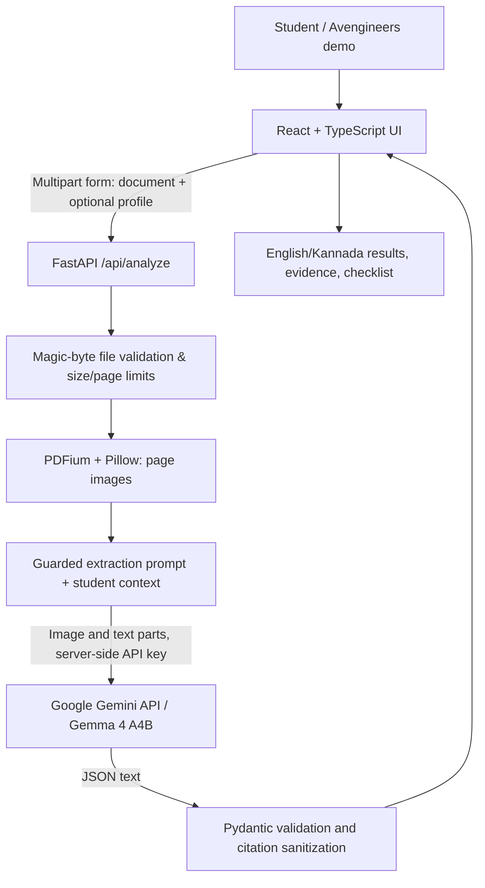

# Design — FormBridge AI

## API
- `GET /api/health`: whether backend and Gemma key are configured.
- `POST /api/analyze`: multipart `file` plus JSON `profile` string.
- `200`: structured `AnalysisResponse` and metadata; `4xx` for client errors; `429` on rate limits; `502/504` for provider failure.

## Data handling
- Model key resides on backend only, via environment variables.
- No permanent upload storage. V3 retains bounded server-memory context for a default 20 minutes for chat; deletion, eviction and expiry release it.
- Uploaded data leaves the app when processed by Google's hosted model API; Google policy applies.
- V3 independently matches proposed quotes to page text; scans/unmatched citations need manual inspection. A matched quote does not prove rule interpretation.

## Deliberate tradeoffs
- PDF pages are rendered to images, so no separate OCR engine is needed.
- No persistent document history, minimizing privacy risk for hackathon prototype.
- Exact application eligibility depends on official rules; guidance is conservative.
- The hosted model needs an internet connection and user-supplied Google AI Studio key.

## V3 Extension

See `docs/architecture.md` for the current runtime flow: independent evidence verification, deterministic comparisons, bounded sessions and grounded `/api/chat`. PDF.js renders the browser's original file; the roadmap stores checkbox IDs only in tab-local sessionStorage. The original flow above documents the v2 foundation.
