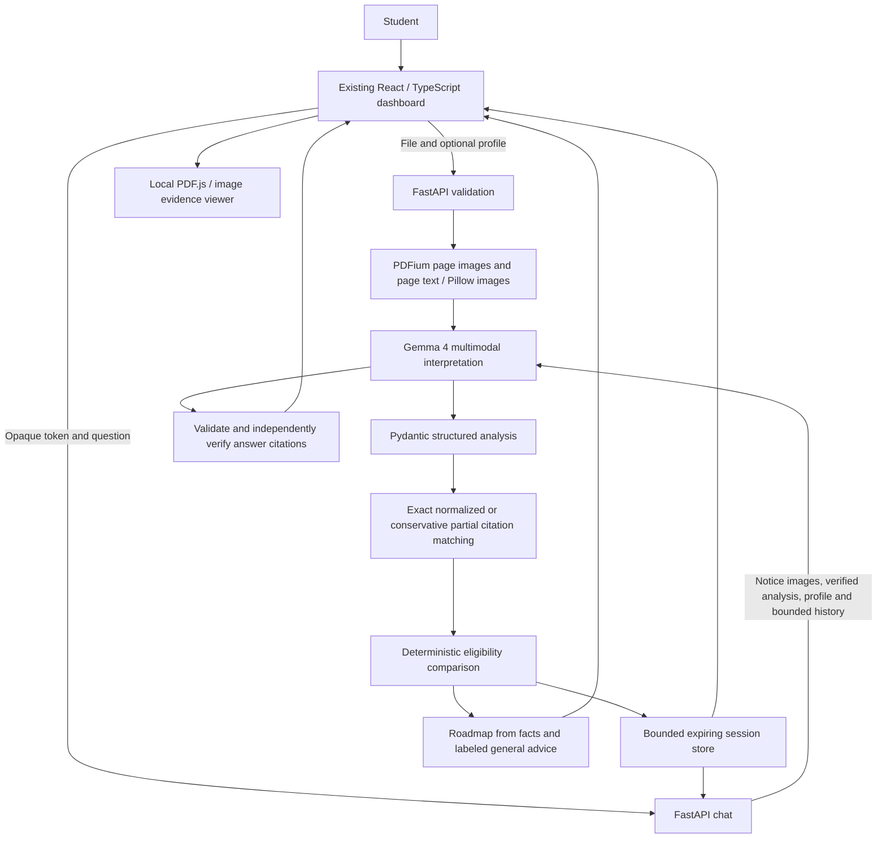

# FormBridge AI 3.0 Architecture

## Ownership

- **Gemma 4:** reads images, interprets the notice, proposes requirements/source quotes, bilingual prose and conversational answers. All model content is untrusted.
- **Python:** validates file bytes, size/page limits, schema and student data; extracts page text; verifies quotations and computes preliminary comparisons; builds roadmap tasks; retains isolated context; retries only appropriate provider failures.
- **React/PDF.js:** displays original browser-local file, citation controls, badges, counts, bilingual labels, chat and checkbox progress. No API key or server document text is returned to the browser unnecessarily.

The original navy/cyan UI, sample notices, GitHub workflow, Kiro files and original submission diagram remain the foundation. The Halloween styling requirement is limited to a future presentation diagram; no Halloween UI redesign is introduced. The preserved original bitmap is historical, not a diagram of the v3 runtime.

## Context lifecycle

An app-owned SessionStore maps cryptographically random bearer tokens to separate dataclasses. Default bounds: 32 entries, accounted 64 MiB, absolute 1,200-second TTL. Each context contains rendered images, page text, validated profile, verified analysis, an async chat lock and at most 12 history messages. Oldest entries are evicted before capacity is exceeded. No sliding refresh. Expired entries are inaccessible and swept every 30 seconds while the app runs. Deletion is explicit and shutdown clears the store. In-flight work may retain references until completion.

No authentication, shared cache, database or multi-worker session routing is implemented. Run one worker. Tokens are capabilities, not account identities. A deployment restart or capacity eviction requires a new analysis.

## Evidence semantics

Matching uses NFKC, case folding, whitespace and punctuation spacing while preserving Unicode combining marks, symbols and digits. Minimum-length quotations must be substrings of the normalized **cited page**, never a different page. A bounded fuzzy window comparison at >=0.88 yields only `partial_match`. Weak/no matches are `unverified`; insufficient page text is `not_available`. Incorrect/out-of-range model pages are removed. No fuzzy match upgrades to verified.

The original quotation is displayed beside the original page. Coordinate highlighting is intentionally unavailable in v3; no positions are guessed. Text matching is not semantic verification of a structured rule, and source authenticity is not assessed.

## Reliability and deployment

Analysis and chat use the same Gemma `generateContent` HTTP client with timeouts, maximum two retries, exponential delay/jitter and carefully bounded Retry-After. No model fallback or fabricated recovery response. Safe structured diagnostic fields correlate with API request IDs. FastAPI adds no-store responses, validated JSON and explicit CORS origins.

Render hosts the existing FastAPI service and Vite static site. The PDF.js worker is bundled locally and the API origin is build-time configurable. Use TLS supplied by the hosting provider and keep the key in private backend environment settings.
